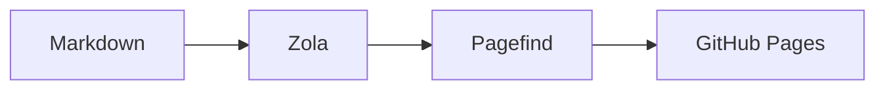

+++
title = "A place for notes"
description = "A site for notes, and three languages I keep coming back to."
date = 2026-10-20

[taxonomies]
tags = ["notes", "site"]

[extra]
hero = "hero.jpg"
hero_alt = "Italian landscape with umbrella pines, painted by Hendrik Voogd"
hero_credit = "Hendrik Voogd, public domain"
hero_credit_url = "https://commons.wikimedia.org/wiki/File:Hendrik_Voogd_-_Italian_landscape_with_Umbrella_Pines.jpg"
toc = true
series = "Notes"
+++

I wanted a page that loads, a typeface I can stand to read, and a folder of files I can edit without an account. This is that page. The next one in the series is [A second note](@/posts/a-second-note/index.md).

## What gets written down

A column of text. A dark mode that does not flash white. Search that still works after the page is built. The painting at the top is Hendrik Voogd's Italian landscape with umbrella pines.[^painting]

## Three snippets

These are the languages I reach for when a note turns into a program.

### Rust

```rust
fn slug(title: &str) -> String {
    title
        .split_whitespace()
        .map(|word| word.to_lowercase())
        .collect::<Vec<_>>()
        .join("-")
}
```

### Kotlin

```kotlin
data class Note(val title: String, val tags: List<String>)

fun Note.isTagged(tag: String) = tag in tags
```

### Go

```go
package notes

import "strings"

func Slug(title string) string {
	return strings.ToLower(strings.Join(strings.Fields(title), "-"))
}
```

## How a post gets published



Zola renders the HTML. Pagefind indexes it. GitHub Pages serves the folder.[^build]

[^painting]: [Italian landscape with umbrella pines](https://commons.wikimedia.org/wiki/File:Hendrik_Voogd_-_Italian_landscape_with_Umbrella_Pines.jpg), public domain.
[^build]: A file with `draft = true` stays out of that folder until the flag is removed.
